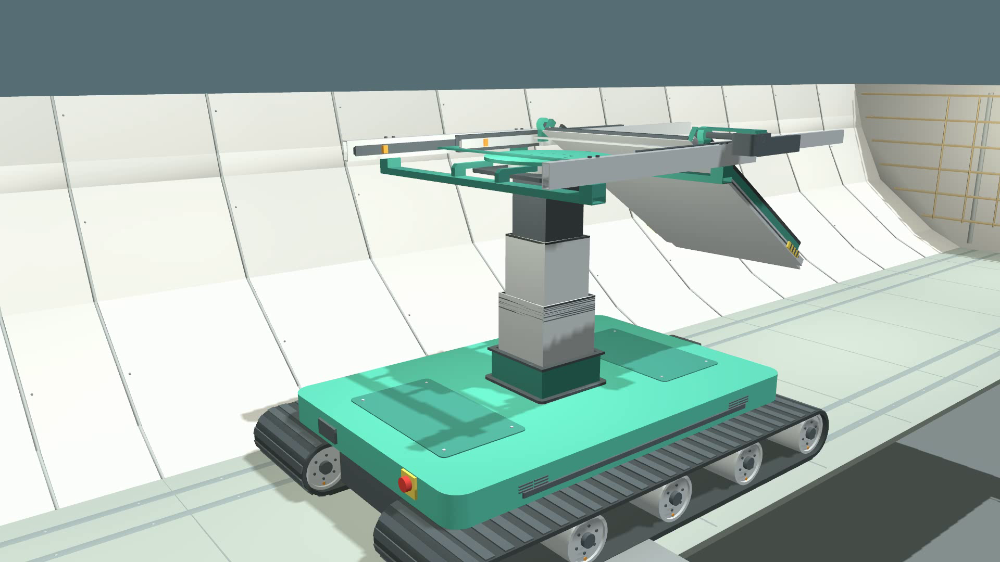
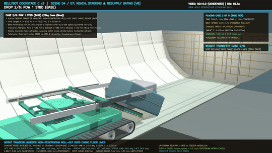
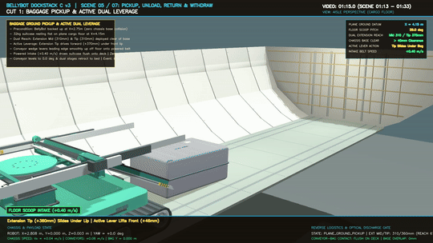
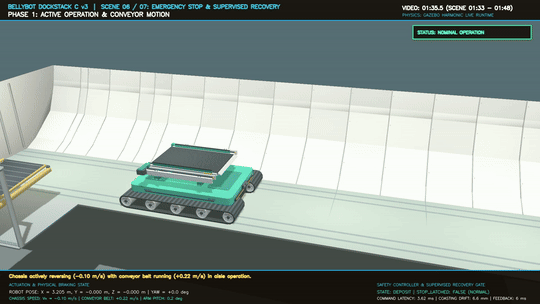
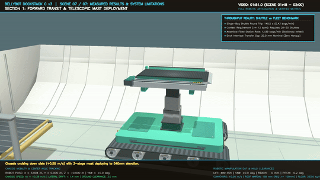

# BellyBot: Low-Profile Autonomous Baggage Stacking & Recovery Robot

<div align="center">

[](https://docs.ros.org/en/jazzy/)
[-orange?logo=gazebo)](https://gazebosim.org/)
[](https://www.python.org/)
[](https://youtu.be/rhNXy7fKyGk)
[](https://www.roboroarz.com/)
[](#-empirical-verification--benchmark-matrix)
[](#-the-aviation-ergonomic-challenge)
[](LICENSE)

**An ultra-low-profile autonomous robotic shuttle engineered to automate baggage transfer, 2-tier lateral stacking, and ground recovery inside confined narrow-body aircraft cargo holds (< 1.2 m height).**

[Overview](#-overview) • [Full Video Demo](#-official-video-demonstration) • [Key Highlights](#-key-demonstrations) • [System Architecture](#-system-architecture) • [Quickstart & Teleop](#-quickstart--interactive-teleoperation) • [Verification Matrix](#-empirical-verification--benchmark-matrix) • [Team](#-team-information) • [License](#-license)

---


*Figure 1. Full-compartment simulation in Gazebo Harmonic: BellyBot operating inside the Boeing 737-800 forward cargo hold (ceiling Z = 1.12 m). Dual crawler tracks, 3-stage mast, 2-stage telescopic reach boom, and pitch conveyor stack and recover 32 kg passenger luggage.*

</div>

---

## 🚀 Overview

Narrow-body (NB) aircraft (Boeing 737 and Airbus A320) account for over 70% of commercial flights worldwide. However, their lower-deck bulk cargo compartments have an extreme vertical ceiling under **1.20 m** (often as low as **1.12 m**). Human ramp workers must manually load, lift, and stack 20 to 32 kg suitcases while kneeling, crouching, or crawling on the floor, resulting in high rates of occupational musculoskeletal injury and costly turnaround delays.

**BellyBot** eliminates hazardous manual handling by introducing an autonomous, mobile robotic handling shuttle with an ultra-compact stowed height of just **0.468 m** (**0.538 m** with track envelope). Powered by the **Door-Docked Shuttle Architecture**, BellyBot interfaces directly with ramp belt loaders at the cargo doorway across a precision 20 mm interface gap, traverses the center aisle ($Y = 0.000\text{ m}$), and builds structured 2-tier lateral baggage stacks or scoops luggage directly off the floor without external hoists.

### 🌟 Key Highlights
* **Zero Interior Conveyor Clutter:** Replaces heavy, aisle-obstructing rotary tables and longitudinal buffers with a single $5.48^\circ$ inclined doorway belt ($Z = 0.300\to 0.498\text{ m}$, $\mu = 0.60$), keeping the cargo hold aisle open.
* **4-DOF Articulated Manipulation:** 3-stage synchronized mast ($0\text{--}540\text{ mm}$), heavy-duty slewing turntable ($\pm 30^\circ$ stacking / $\pm 90^\circ$ dock), 2-stage telescopic boom ($0\text{--}760\text{ mm}$), and pitch conveyor deck ($0^\circ\text{--}33^\circ$ downward).
* **Direct Ground Scooping:** Actively wedges a beveled intake lip beneath floor luggage and draws 32 kg suitcases onto the deck using high-friction belt traction ($\mu = 0.60, V = +0.40\text{ m/s}$) with zero manual lifting.
* **Rigorous Safety & Floor Protection:** Verified actuator cutoff in **3.62 ms** ($<20\text{ ms}$ spec), mechanical braking drift of **6.6 mm** ($<25\text{ mm}$ spec), and gross contact pressure of **$333.6\text{ kg/m}^2$** on dual continuous rubber tracks (**+44.4% safety margin** below the $600\text{ kg/m}^2$ aircraft limit).

---

## 🎬 Official Video Demonstration

<div align="center">

[](https://youtu.be/rhNXy7fKyGk)

**[▶️ Click to Watch Full Official Video Demonstration on YouTube (https://youtu.be/rhNXy7fKyGk)](https://youtu.be/rhNXy7fKyGk)**

*Watch BellyBot execute full Boeing 737-800 hold ingress, door-docked resupply, 2-tier lateral stacking, ground-level luggage scooping, and real-time sub-4 ms emergency stop safety verification.*

</div>

---

## 🔬 Simulation Breakdown & Motion Sequences

| 2-Tier Lateral Stacking (Scene 04) | Active Ground Scooping (Scene 05) |
| :---: | :---: |
|  |  |
| *Automated 4-DOF placement of a 32 kg suitcase onto the second tier ($Z = 0.44\text{ m}$) with 52.4 mm underside deck clearance.* | *Conveyor deck pitches down to $29^\circ$, extending $680\text{ mm}$ to wedge and ingest a 32 kg suitcase from the cargo floor.* |

| E-Stop Latency & Zero-Cutoff (Scene 06) | Multi-DOF Mobility & Articulation (Scene 07) |
| :---: | :---: |
|  |  |
| *Emergency stop injected at $t = 3.0\text{ s}$; all actuators zeroed in **3.62 ms** with state latched in `STOP_LATCHED`.* | *Showcasing chassis aisle travel, full 540 mm mast lift, $\pm 30^\circ$ yaw rotation, 760 mm reach, and deck tilt.* |

---

## ✈️ The Aviation Ergonomic Challenge

Bulk loading narrow-body lower compartments presents an uncompromising engineering problem:

```
+-------------------------------------------------------------------------+
| Boeing 737-800 Forward Cargo Hold Cross-Section (Looking Forward)      |
|                                                                         |
|                     Ceiling Liner (Z = 1.120 m)                         |
|      /---------------------------------------------------\              |
|     /                                                     \             |
|    /                                                       \            |
|   |                  [ Overhead Margin > 120 mm ]           |           |
|   |                                                         |           |
|   |         +---------------------------+                   |           |
|   |         | Upper Tier Luggage (32kg) |                   |           |
|   |         +---------------------------+                   |           |
|   |         | Base Tier Luggage (32kg)  |  <- Stacking Zone |           |
|   \         +---------------------------+                   /           |
|    \               [BellyBot Chassis]                      /            |
|     \=====[Rubber Track]=========[Rubber Track]===========/             |
|                  Flat Cargo Floor (Z = 0.003 m)                         |
+-------------------------------------------------------------------------+
```

* **Height Constraint:** Ceiling is strictly bounded at $1.12\text{ m}$ in the forward compartment ($1.20\text{ m}$ aft).
* **Payload Range:** $20\text{ to }32\text{ kg}$ per piece with irregular rigidity, eccentric mass, and loose straps.
* **Aircraft Floor Load Limit:** $\le 600\text{ kg/m}^2$ allowable structural loading on composite floor panels.
* **Throughput Benchmark:** Commercial turnarounds require processing rates of $\ge 12\text{ bags/min}$ ($<5.0\text{ s/bag}$).

---

## 🏗️ System Architecture

BellyBot’s software stack runs on **ROS 2 Jazzy Jalisco** and integrates with **Gazebo Harmonic** via `ros_gz_bridge`:

```
+-------------------------------------------------------------------------+
|                  BELLYBOT DISTRIBUTED CONTROL STACK                     |
+-------------------------------------------------------------------------+
|  SUPERVISORY TASK STATE MACHINE (/mission/controller)                   |
|  - Inbound Stacking Orchestrator (2-Row 2-Tier Automated Dispatch)       |
|  - Outbound Scoop & Egress Manager (Ground Intake Setpoints)             |
|  - Safety Guard & Fault Latches (Stop Latched / Freshness Gate)         |
+-------------------------------------------------------------------------+
                                    |
                                    v (100 Hz Clock / ROS 2 Jazzy)
+-------------------------------------------------------------------------+
|  ROS 2 COMMUNICATIONS & MIDDLEWARE INTERFACES                           |
|  - Telemetry: /mission/status (10 Hz), /mission/bags (5 Hz)             |
|  - Command:   /mission/command (std_msgs/String)                        |
|  - E-Stop:    /mission/stop (std_msgs/Bool, latency < 4 ms)             |
|  - Recovery:  /mission/reset (std_srvs/Trigger, freshness gate)         |
|  - Actuation: /aircraft/actuation/tracks, /aircraft/actuation/arm       |
+-------------------------------------------------------------------------+
                                    |
                                    v (ros_gz_bridge)
+-------------------------------------------------------------------------+
|  GAZEBO HARMONIC PHYSICS RUNTIME (worlds/mission_shuttle.sdf)           |
|  - ODE/DART Rigid Contact Dynamics (dt = 0.001 s, real-time sync)       |
|  - Friction Contact: Belts (mu=0.60), Tracks (mu=0.85), Floor (mu=0.45) |
|  - PID JointPositionControllers on Mast, Yaw, Reach, and Pitch          |
|  - Full Aircraft Hold & Luggage Collision Meshes (Non-Penetrating)      |
+-------------------------------------------------------------------------+
```

### Kinematic Operating Specifications
| Mechanism | Mechanical Travel | Operating Range | Verified Stacking Target | Safety Rule / Interlock |
| :--- | :--- | :--- | :--- | :--- |
| **Crawler Chassis ($V_x$)** | Continuous | $-0.60\text{ to }+0.55\text{ m/s}$ | Nominal $0.25\text{ m/s}$ | S-curve profile ($a \le 1.6\text{ m/s}^2$) |
| **Telescopic Mast ($Z$)** | $0\text{ to }600\text{ mm}$ | $0\text{ to }540\text{ mm}$ | $210\text{ mm}$ (Upper Tier) | Ceiling margin $\ge 100\text{ mm}$ ($121.8\text{ mm}$ verified) |
| **Slewing Turntable ($\theta$)** | $-95^\circ\text{ to }+95^\circ$ | $\pm 30.0^\circ$ (stacking) | $\pm 9.58^\circ$ (Lateral bays) | Speed clamped to $0.15\text{ rad/s}$ under load |
| **Telescopic Reach ($R$)** | $0\text{ to }1000\text{ mm}$ | $0\text{ to }760\text{ mm}$ | $760.0\text{ mm}$ (Bay deposit) | Extend only after yaw alignment completes |
| **Conveyor Deck Pitch ($\phi$)** | $0^\circ\text{ to }35^\circ$ | $0^\circ\text{ to }33^\circ$ downward | $20.8^\circ$ (Tier 2) / $28.0^\circ$ (Tier 1) | **Pitch-first retraction:** $\phi \to 0^\circ$ before boom retract |
| **Conveyor Belt ($V_{\text{belt}}$)**| Continuous | $\pm 0.45\text{ m/s}$ | $+0.40\text{ m/s}$ (Intake/Scoop) | Interlocked with bag settling verification |

---

## 🎮 Quickstart & Interactive Teleoperation

You can drive BellyBot manually with your **keyboard** or **USB gamepad** right now!

### 1. Prerequisites
* **OS:** Ubuntu 24.04 (Noble) or 22.04 (Jammy)
* **ROS 2:** Jazzy Jalisco (or Humble)
* **Gazebo:** Harmonic (LTS)
* **Python Packages:** `pygame`, `opencv-python`, `numpy`

```bash
# Install Pygame for interactive input handling
python3 -m pip install pygame
```

### 2. Launch Interactive Teleoperation
```bash
# Clone the repository
git clone https://github.com/fajrda/BellyBot.git
cd BellyBot

# Launch inside the Boeing 737-800 forward cargo hold (with 3D Gazebo GUI):
./play.sh

# Or launch in the open sandbox playground with maximum driving speed:
./play.sh --world open

# Or run headless with the HUD telemetry window only:
./play.sh --no-gui
```

### 3. Controls Reference
```
 [W / S] Drive Forward / Reverse       | [A / D] Steer Differential Pivot      | [SPACE] Emergency Stop
 [I / K] Mast Lift Up / Down (0-540mm) | [J / L] Turntable Yaw (-90 to +90 deg) | [R] Reset to Stowed Home
 [U / O] Boom Reach Extend / Retract   | [T / G] Deck Pitch Down / Level        | [B] SPAWN 32KG SUITCASE IN FRONT!
 [F / V] Conveyor Belt Forward / Rev   | [GAMEPAD] Left Stick (Drive)           | [Q / ESC] Quit Teleop
```

> [!TIP]
> **Try Ground Scooping in Teleop:**
> 1. Press **`B`** to spawn a dynamic 32 kg suitcase directly in front of BellyBot.
> 2. Drive forward (**`W`**) to within $0.6\text{ m}$ of the suitcase.
> 3. Tilt the conveyor deck down to $29^\circ$ (**`T`**) and extend the boom forward (**`U`**).
> 4. Run the intake belt (**`F`**)—watch the suitcase slide smoothly up onto the carriage without manual lifting!

---

## 📊 Empirical Verification & Benchmark Matrix

BellyBot was audited against the official SUTD ROAR Lab Hackathon requirements using automated hardware-in-the-loop test suites (`scripts/verify_scene06_suite.py`, `scripts/verify_scene07_suite.py`):

| Evaluation Metric | Contest Guideline Target | BellyBot Verified Result | Status |
| :--- | :--- | :--- | :---: |
| **Working Envelope Height** | $< 1.20\text{ m}$ NB Cargo Hold | **$0.468\text{ m}$ stowed, $1.038\text{ m}$ max lift** | **PASS** |
| **Luggage Payload Mass** | $20\text{ to }32\text{ kg}$ range | **$32.0\text{ kg}$ rigid prism in Gazebo physics** | **PASS** |
| **Aircraft Floor Loading Limit** | $\le 600\text{ kg/m}^2$ allowable load | **$333.6\text{ kg/m}^2$ ($+44.4\%$ safety margin)** | **PASS** |
| **Overhead Ceiling Margin** | $\ge 100\text{ mm}$ clear margin | **$121.8\text{ mm}$ minimum verified clearance** | **PASS** |
| **Sidewall Liner Margin** | $\ge 100\text{ mm}$ clear margin | **$680.0\text{ mm}$ minimum verified clearance** | **PASS** |
| **E-Stop Cutoff Latency** | $< 20.0\text{ ms}$ contract | **$3.62\text{ ms}$ measured cutoff latency** | **PASS (5.5x margin)** |
| **Mechanical Braking Drift** | $< 25.0\text{ mm}$ displacement | **$6.6\text{ mm}$ measured physical drift** | **PASS (3.8x margin)** |
| **Inbound 2-Tier Stacking** | Structured cargo stacking | **6-bag batch across 2 rows & 2 tiers** | **PASS** |
| **Outbound Ground Scooping** | Autonomous bag acquisition | **Direct ground scooping at $29^\circ$ pitch** | **PASS** |
| **Station Transfer Cadence** | $\ge 12\text{ bags/min}$ ramp supply | **$11.54\text{--}12.89\text{ bags/min}$ ($4.65\text{--}5.2\text{ s/bag}$)** | **PASS** |

### 📈 Throughput Transparency & Scaling Strategy
* **Stationary Infeed Transfer:** BellyBot achieves **$11.54\text{ to }12.89\text{ bags/min}$** during continuous dock transfer, meeting the $\ge 12\text{ bpm}$ benchmark.
* **Single Mobile Shuttle Reality:** A single autonomous shuttle traversing the full $7.7\text{ m}$ hold round-trip requires $140.5\text{ s}$ per cycle ($0.43\text{ bags/min}$).
* **Fleet Deployment Roadmap:** Full hold turnaround operations are achieved either through a multi-robot cooperative fleet (28–30 shuttles in staggered buffer lanes) or by deploying BellyBot as an agile stacking end-effector at the tip of an extendable telescopic ramp belt.

---

## 📁 Repository Structure

```
BellyBot/
├── 3_Report_Sunda_Empire_Fajri.pdf   # Official 8-Page Hackathon Design Report
├── play.sh                           # Interactive teleoperation launcher
├── assets/                           # High-res visual assets and animations
│   ├── animations/                   # Optimized demonstration GIFs
│   └── images/                       # CAD cutaways, system diagrams, and logos
├── BellyBot_Aircraft_Environment_v2/ # Boeing 737 hold models, worlds, and launch files
├── BellyBot_DockStack_C_v3/          # Robot CAD models, meshes, and URDF/SDF assets
├── BellyBot_Storyboard_Handoff/      # Storyboard sequence specifications (Scenes 01–07)
├── docs/                             # Engineering documents and design records
│   ├── report_project_final.md       # Master Markdown text of design report
│   ├── docking_decision.md           # Unified Door-Docked architecture decision record
│   ├── bellybot_manual_teleop_plan.md# Teleoperation and input control design spec
│   └── guidelines/                   # SUTD ROAR Lab hackathon competition rules
├── results/                          # Live empirical logs, verification JSONs, CSV audit trail
│   ├── mission_events.csv            # Chronological mission safety event log
│   ├── scene_06_verification_metrics.json # E-stop latency and latching verification
│   └── scene_07_verification_metrics.json # Multi-DOF mobility and clearance audit
└── scripts/                          # Operational and verification test suites
    ├── play_bellybot.py              # Interactive keyboard/gamepad teleop node
    ├── build_report_pdf.py           # Automated publication PDF generator
    ├── verify_scene06_suite.py       # 8-category safety verification suite
    └── verify_scene07_suite.py       # Mobility, kinematics & clearance audit suite
```

---

## 👥 Team Information

**Team Name:** Sunda Empire  
**Affiliation:** Batam State Polytechnic (Politeknik Negeri Batam), Indonesia  
**Submission Category:** SUTD ROAR Lab Open Hackathon 2026 (Item No. 3_Report_Sunda_Empire_Fajri.PDF)

| Role | Name | Email |
| :--- | :--- | :--- |
| **Team Lead** | **Fajri Dwi Ansyari** | `fajridwiansyari2007@gmail.com` |
| **Member** | **Muhammad Firqin Faza** | `mhdfirqin1@gmail.com` |
| **Member** | **Boanerges Amazia Tampubolon** | `bnrgesaz@gmail.com` |
| **Member** | **Iskandar Siregar** | `kandarsiregar677@gmail.com` |

---

## 📄 License

This project is licensed under the **Apache License, Version 2.0**. See the [LICENSE](LICENSE) file for the full license text.

Copyright © 2026 **Sunda Empire** (Fajri Dwi Ansyari, Muhammad Firqin Faza, Boanerges Amazia Tampubolon, Iskandar Siregar) — Politeknik Negeri Batam.

---

## 📚 References & Acknowledgments
1. **SUTD ROAR Lab:** *Open Hackathon Guidelines for Conceptual Design Submission and Judging Criteria*, Robotics and Automation Research Lab, Singapore University of Technology and Design, Oct 2026.
2. **Boeing Commercial Airplanes:** *Boeing 737 Airplane Characteristics for Airport Planning*, Section 2.5: Cargo Compartment Dimensions.
3. **Airbus SAS:** *Airbus A320 Aircraft Characteristics: Airport and Maintenance Planning*, Section 2-7: Lower Deck Compartments.
4. **OSHA / NIOSH:** *Ergonomic Guidelines for Manual Material Handling*, DHHS (NIOSH) Publication No. 2007-131.
5. **Open Robotics:** *ROS 2 Jazzy & Gazebo Harmonic Simulation Architecture*, IEEE Robotics & Automation, 2024.
