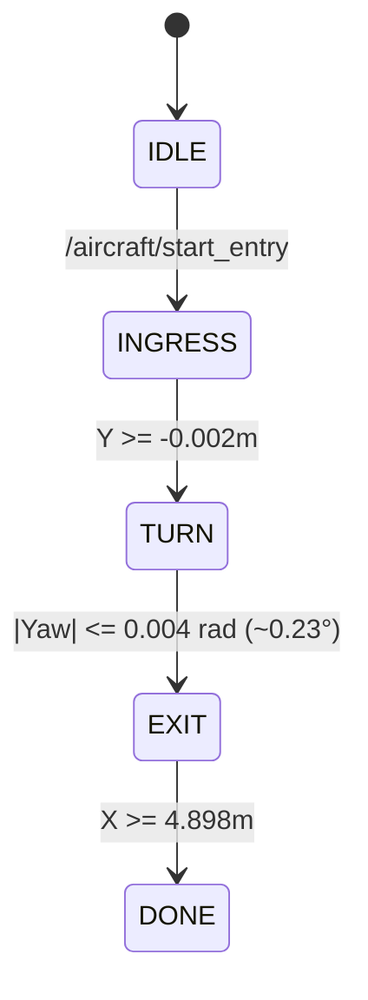

# Storyboard Segment 1: Access & Ingress (0:00 – 0:25)
## Technical ROS 2 Architecture & Simulation Approach

**Segment Duration:** 25 Seconds  
**Focus:** Doorway entry navigation, $90^\circ$ pivot on the elevated turn deck, and ramp descent into the B737-800 cargo hold aisle.  
**Primary Judging Criterion:** NB Aircraft Cargo-Hold Compatibility & Space Utilisation (15%), Feasibility & Technical Soundness (15%).

---

## 1. Visual Objectives & Camera Setup for Video Production

### 1.1 Shot List & Cinematic Directives
- **Shot 1.1 (0:00 – 0:08) — Exterior Cargo Door Ingress:**
  - *Angle:* Low 3/4 isometric exterior view looking at the Boeing 737 cargo door ($1.22\text{ m} \times 0.89\text{ m}$).
  - *Visual Goal:* Show the robot docked on the exterior belt loader service platform ($Y = -3.29\text{ m}$) moving through the narrow door sill. Highlight clear lateral margins ($60\text{ mm}$ per side) and stowed height ($0.468\text{ m}$ vs $0.89\text{ m}$ door height).
- **Shot 1.2 (0:08 – 0:17) — Turn Deck $90^\circ$ In-Place Pivot:**
  - *Angle:* Top-down or high-angle cutaway view focusing on the $180\text{ mm}$ turn deck ($X = 1.30\text{ m}, Y = 0.00\text{ m}$).
  - *Visual Goal:* Show differential track rotation pivoting from transverse entry axis ($+Y$) to longitudinal cargo hold centerline ($+X$). Demonstrate negligible center drift ($< 2\text{ mm}$, well within the $15\text{ mm}$ safety envelope).
- **Shot 1.3 (0:17 – 0:25) — Ramp Descent onto Hold Floor:**
  - *Angle:* Longitudinal aisle view inside the hold looking from $X = 5.5\text{ m}$ back toward the ramp.
  - *Visual Goal:* Show tracks descending the $5.71^\circ$ inclined ramp, pitch tilting smoothly to $5.81^\circ$, and settling onto the aluminum floor panels at datum $X = 4.90\text{ m}$ without rolling ($0.0^\circ$ roll).

### 1.2 Camera Poses in Gazebo SDF
```xml
<!-- Shot 1.1: Exterior Isometric Doorway Ingress -->
<gui fullscreen='0'>
  <camera name='camera_ingress'>
    <pose>2.8 -4.5 1.4 0 0.28 2.25</pose>
    <view_controller>orbit</view_controller>
  </camera>
</gui>

<!-- Shot 1.2: Overhead Turn Deck Pivot -->
<camera name='camera_turn'>
  <pose>1.30 0.00 2.20 0 1.5708 0</pose>
</camera>

<!-- Shot 1.3: Aisle Perspective on Ramp Descent -->
<camera name='camera_ramp'>
  <pose>5.20 0.85 0.95 0 0.12 -2.85</pose>
</camera>
```

---

## 2. Technical ROS 2 Architecture

### 2.1 Nodes & Parameters
- **Controller Node:** `bellybot_aircraft_environment/aircraft_controller.py`
  - Parameter: `mode: 'entry'`
  - Parameter: `use_sim_time: true`
- **Gazebo Bridge:** `ros_gz_bridge/parameter_bridge` using `config/aircraft_bridge.yaml`
- **Verification Script:** `scripts/verify_entry_milestone.py`

### 2.2 Active ROS 2 Topics & Types
| Topic Name | Message Type | Direction | Rate | Functional Purpose |
|---|---|---|---|---|
| `/aircraft/start_entry` | `std_msgs/msg/Empty` | Verifier $\to$ Controller | One-shot | Triggers ingress state machine from stowed initial state |
| `/aircraft/robot_pose` | `tf2_msgs/msg/TFMessage` | Gazebo Bridge $\to$ Controller | 50 Hz | Ground-truth odometry transform for chassis datum tracking |
| `/aircraft/actuation/cmd_vel` | `geometry_msgs/msg/Twist` | Controller $\to$ Gazebo Bridge | 50 Hz | Commanded linear speed $v_x$ and angular yaw rate $\omega_z$ |
| `/aircraft/actuation/left_wheel_speed` | `std_msgs/msg/Float64` | Controller $\to$ Gazebo Bridge | 50 Hz | Left track sprocket drive velocity command |
| `/aircraft/actuation/right_wheel_speed` | `std_msgs/msg/Float64` | Controller $\to$ Gazebo Bridge | 50 Hz | Right track sprocket drive velocity command |
| `/aircraft/status` | `std_msgs/msg/String` | Controller $\to$ Verifier | 2 Hz | JSON telemetry (`entry` state, error status, pose fresh) |

---

## 3. Simulation Mechanics & Technical Approach

### 3.1 Closed-Loop Navigation Control Laws
The controller implements a 3-stage kinematic finite-state machine governed by verified aircraft boundary limits:



#### 1. INGRESS Stage ($Y = -3.29\text{ m} \to -0.002\text{ m}$):
- Forward speed: $v = \min(0.08, \max(0, -y \times 0.6))\text{ m/s}$
- Heading steering: $\omega = \max(-0.02, \min(0.02, (\pi/2 - \text{ang}) \times 1.2))\text{ rad/s}$
- **Safety Interlock:** If $|x - 1.300| > 0.012\text{ m}$ or $|\text{ang} - \pi/2| > 0.012\text{ rad}$, the supervisor latches `Door path tracking error` and brings velocities to zero.

#### 2. TURN Stage ($90^\circ \to 0^\circ$ at $X = 1.300\text{ m}, Y = 0.000\text{ m}$):
- Pure yaw pivot: $\omega = -\min(0.08, \max(0.015, \text{ang} \times 0.8))\text{ rad/s}$, $v = 0$
- **Drift Guard:** Monitored center radius $\sqrt{(x-1.3)^2 + y^2} \le 0.015\text{ m}$. Observed drift is $< 2\text{ mm}$.
- Transition: When $|\text{ang}| < 0.004\text{ rad}$ ($0.23^\circ$), robot latches alignment and switches to `EXIT`.

#### 3. EXIT Stage ($X = 1.32\text{ m} \to 4.898\text{ m}$):
- Descent speed: $v = \min(0.08, \max(0, (4.9 - x) \times 0.6))\text{ m/s}$
- Centerline steering: $\omega = \max(-0.02, \min(0.02, -\text{ang} \times 1.2))\text{ rad/s}$
- Transition: When $X \ge 4.898\text{ m}$, state enters `DONE` and tracks come to a stop.

### 3.2 Gazebo Physical Modeling
- **World File:** `BellyBot_Aircraft_Environment_v2/ros2/bellybot_aircraft_environment/worlds/entry_resolved.sdf`
- **Tracked Vehicle Physics:** Gazebo Harmonic `gz::sim::systems::TrackedVehicle` plugin:
  - Track separation: $0.75\text{ m}$
  - Drive radius: $0.068\text{ m}$
  - Sprocket velocity: $\omega_L = (v - \omega \times 0.375) / 0.068$, $\omega_R = (v + \omega \times 0.375) / 0.068$
  - Surface slip: Linear contact-surface traction with ODE friction $\mu_1 = 1.0, \mu_2 = 1.0$.

---

## 4. Step-by-Step Recording & Verification Workflow

### 4.1 Launching and Verifying Non-Interactively
```bash
# Terminal 1: Launch simulation and automated verifier
source /opt/ros/jazzy/setup.bash && source /home/fajrda/sutd-hackathon/ros2_ws/install/setup.bash
python3 -u /home/fajrda/sutd-hackathon/scripts/verify_entry_milestone.py
```

### 4.2 Capturing Video for the Submission Clip
To capture clean 60 FPS video without GUI stutter:
```bash
# 1. Launch with GUI camera active
ros2 launch bellybot_aircraft_environment aircraft.launch.py mode:=entry cutaway:=false

# 2. In parallel terminal, record Gazebo window or screen region
ffmpeg -f x11grab -video_size 1280x800 -framerate 60 -i :0.0+100,100 \
       -c:v libx264 -preset slow -crf 18 -pix_fmt yuv420p \
       videos/segment_01_access_ingress.mp4
```

### 4.3 On-Screen Annotation Guidelines
- Overlay title card at 0:01: `PHASE 1: ACCESS & DOORWAY INGRESS`
- Display HUD telemetry box:
  - `Door Aperture: 1.22 m × 0.89 m (Clears with +422 mm vertical margin)`
  - `Pivot Drift: < 2 mm (Envelope limit: 15 mm)`
  - `Ramp Gradient: 5.71° | Roll Deviation: 0.00°`
