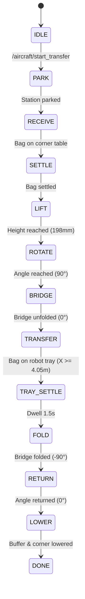

# Storyboard Segment 2: Continuous Infeed Transfer (0:25 – 0:55)
## Technical ROS 2 Architecture & Simulation Approach

**Segment Duration:** 30 Seconds  
**Focus:** 5-stage continuous conveyor cascade, corner table lift and $90^\circ$ rotation, bridge unfolding, buffer travel, and zero-jam payload handoff onto the BellyBot receiving tray.  
**Primary Judging Criterion:** Functional Effectiveness & Baggage Handling Strategy (20%), Innovation & Creativity (20%), Feasibility (15%).

---

## 1. Visual Objectives & Camera Setup for Video Production

### 1.1 Shot List & Cinematic Directives
- **Shot 2.1 (0:25 – 0:35) — Doorway Infeed to Corner Table Lift & Pivot:**
  - *Angle:* High cutaway view looking through the cargo doorway into the corner module ($X = 1.30\text{ m}, Y = 0.00\text{ m}$).
  - *Visual Goal:* Show the $32\text{ kg}$ suitcase entering via the door belt ($Z = 0.462\text{ m}$), transitioning onto the corner deck, rising $+198\text{ mm}$ ($H = 0.198\text{ m}$), and smoothly pivoting $90^\circ$ to face the hold centerline.
- **Shot 2.2 (0:35 – 0:45) — Bridge Plate Deployment & Buffer Conveyance:**
  - *Angle:* Longitudinal tracking shot along the aisle ($X = 1.30\text{ m} \to 3.65\text{ m}$).
  - *Visual Goal:* Show the motorized bridge plate unfolding from $-90^\circ$ to $0^\circ$ flat, creating a continuous bridge. Show the suitcase gliding rapidly down the longitudinal buffer belt under continuous powered contact.
- **Shot 2.3 (0:45 – 0:55) — Robot Tray Handoff & Auto-Stow Sequence:**
  - *Angle:* Close-up macro view of the buffer-to-robot interface ($X = 3.65\text{ m}$).
  - *Visual Goal:* Highlight the seamless crossing across the $2\text{ mm}$ gap onto BellyBot's motorized receiving tray. Show the bag settling at datum ($X = 4.106\text{ m}, Y = 0.000\text{ m}, Z = 0.655\text{ m}$), followed by the bridge plate folding back to $-90^\circ$ and corner rotor returning to ground stow.

### 1.2 Camera Poses in Gazebo SDF
```xml
<!-- Shot 2.1: Corner Table Lift and Pivot Cutaway -->
<camera name='camera_corner_lift'>
  <pose>0.40 -1.80 1.25 0 0.42 1.12</pose>
</camera>

<!-- Shot 2.2: Longitudinal Buffer Conveyor Track -->
<camera name='camera_buffer_travel'>
  <pose>2.10 -1.10 1.10 0 0.35 1.5708</pose>
</camera>

<!-- Shot 2.3: Close-up Handoff at Robot Tray Interface -->
<camera name='camera_tray_handoff'>
  <pose>4.40 -0.85 0.95 0 0.30 2.45</pose>
</camera>
```

---

## 2. Technical ROS 2 Architecture

### 2.1 Nodes & State Machine
- **Controller Node:** `bellybot_aircraft_environment/aircraft_controller.py` (`mode: 'transfer'`)
- **Transfer State Machine:** `transfer_core.py` (instantiated within controller)
- **Gazebo Bridge:** `ros_gz_bridge/parameter_bridge` with topics configured in `aircraft_bridge.yaml`



### 2.2 Active ROS 2 Topics & Actuation Commands
| Topic Name | Message Type | Rate | Function |
|---|---|---|---|
| `/aircraft/start_transfer` | `std_msgs/msg/Empty` | One-shot | Starts automated transfer cycle |
| `/aircraft/actuation/door_speed` | `std_msgs/msg/Float64` | 50 Hz | Infeed door belt linear speed ($0.30\text{ m/s}$) |
| `/aircraft/actuation/corner_speed` | `std_msgs/msg/Float64` | 50 Hz | Corner deck roller conveyor speed ($0.30\text{ m/s}$) |
| `/aircraft/actuation/bridge_speed` | `std_msgs/msg/Float64` | 50 Hz | Bridge plate belt speed ($0.30\text{ m/s}$) |
| `/aircraft/actuation/buffer_speed` | `std_msgs/msg/Float64` | 50 Hz | Longitudinal buffer conveyor speed ($0.30\text{ m/s}$) |
| `/aircraft/actuation/tray_belt_speed` | `std_msgs/msg/Float64` | 50 Hz | Robot receiving tray belt speed ($0.25\text{ m/s}$) |
| `/aircraft/actuation/corner_stage_1..3` | `std_msgs/msg/Float64` | 50 Hz | 3-stage rotary lift target ($H/3 = 0.066\text{ m}$ each) |
| `/aircraft/actuation/corner_angle` | `std_msgs/msg/Float64` | 50 Hz | Corner deck yaw target ($90^\circ = 1.5708\text{ rad}$) |
| `/aircraft/actuation/bridge_angle` | `std_msgs/msg/Float64` | 50 Hz | Bridge deployment angle ($0\text{ rad}$ flat, $-1.5708\text{ rad}$ folded) |
| `/aircraft/actuation/buffer_stage_1..2` | `std_msgs/msg/Float64` | 50 Hz | Buffer telescope lift target ($B/2 = 0.065\text{ m}$ each) |
| `/aircraft/world_poses` | `tf2_msgs/msg/TFMessage` | 50 Hz | SceneBroadcaster tracked bag coordinate feedback |

---

## 3. Contact Mechanics & Simulation Technical Solutions

### 3.1 Contact Physics Resolution Summary
To ensure 100% reliable baggage transit without physics clipping or friction snags:

```
Buffer Deck (X: 1.30m -> 3.654m)      Robot Tray (X: 3.658m -> 4.530m)
┌─────────────────────────────────┐   ┌─────────────────────────────┐
│ buffer_belt_contact             │   │ tray_belt_collision_0       │
│ Active moving surface (v=0.3m/s)│   │ Active moving surface       │
└───────────────────────────┬─────┘   └───────▲─────────────────────┘
                 tail_deadplate               │
                 Native <box> (μ=0.05) ───────┘ 2 mm nominal gap
                 Z_step = +0.5 mm downward waterfall
```

1. **Deadplate Replacement:** In `models/longitudinal_buffer/model.sdf`, removed the faceted CAD STL mesh `tail_deadplate` and substituted a native ODE collision box:
   ```xml
   <collision name="tail_deadplate">
     <pose relative_to="buffer_stage_2">0.951 0 0.001 0 0 0</pose>
     <geometry><box><size>0.010 0.59 0.002</size></box></geometry>
     <surface><friction><ode><mu>0.05</mu><mu2>0.05</mu2></ode></friction></surface>
   </collision>
   ```
2. **Powered Belt Extension:** Extended `buffer_belt_contact` length to $1.898\text{ m}$ ($X_{max} = 0.954\text{ m}$ in buffer frame, $X_{world} = 3.654\text{ m}$).
3. **Receiving Tray Alignment:** Aligned robot `tray_belt_collision_0` in `transfer_cutaway.sdf` and `bellybot_dock_stack.sdf` to:
   ```xml
   <collision name="tray_belt_collision_0">
     <pose>0.424 0 -0.00925 0 0 0</pose>
     <geometry><box><size>0.872 0.55 0.0015</size></box></geometry>
   </collision>
   ```
   Leading edge is positioned at exactly $X_{world} = 3.658\text{ m}$, providing a clean $2\text{ mm}$ clearance gap and $0.5\text{ mm}$ downward waterfall.
4. **Buffer Cascade Matching:** In `transfer_core.py`, buffer lift target set to $B = 0.130\text{ m} + h$, establishing an uninterrupted downward slope from corner table across the bridge plate.

---

## 4. Step-by-Step Recording & Verification Workflow

### 4.1 Launching Automated Transfer
```bash
source /opt/ros/jazzy/setup.bash && source /home/fajrda/sutd-hackathon/ros2_ws/install/setup.bash
# Spawns 32 kg test suitcase and runs full 5-stage transfer sequence
python3 -u /home/fajrda/sutd-hackathon/scripts/verify_transfer_milestone.py
```

### 4.2 HUD Overlay Telemetry Directives
- **0:25:** Overlay: `PHASE 2: 5-STAGE CONTINUOUS INFEED CONVEYOR CASCADE`
- **0:30:** Label Corner Module: `Corner Rotary Deck: Lift +198 mm, Rotation 90°`
- **0:40:** Label Buffer Conveyor: `Longitudinal Buffer: Continuous Powered Transfer (0.30 m/s)`
- **0:50:** Label Handoff Datum: `Docking Handoff at X = 3.658 m | Settle Datum: X = 4.106 m`
- **Metric Badge:** `Target Throughput: ≥ 12 bags/min | Tested Payload: 32 kg Heavy Suitcase`
