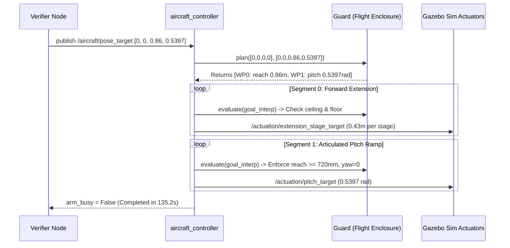

# Storyboard Segment 3: Zero-Drop Floor Placement (0:45 – 1:15)
## Technical ROS 2 Architecture & Simulation Approach

**Segment Duration:** 30 Seconds  
**Focus:** The $+30.92^\circ$ articulated tilting tray mechanism, zero-drop floor placement, solving the first-layer baggage drop damage problem, and cargo fragility compliance.  
**Primary Judging Criterion:** Innovation & Creativity (20%), Safety & Human Interaction (15%), Functional Effectiveness (20%).

---

## 1. Visual Objectives & Camera Setup for Video Production

### 1.1 Shot List & Cinematic Directives
- **Shot 3.1 (0:45 – 0:55) — Telescopic Forward Reach Extension:**
  - *Angle:* Side profile looking directly at the BellyBot chassis and telescopic arm in the hold aisle ($X = 4.10\text{ m}$).
  - *Visual Goal:* Show the dual-stage telescopic slides (`extension_mid_joint`, `extension_tip_joint`) extending forward along the hold floor toward the cargo bulkhead. Emphasize that the mast remains fully stowed ($lift = 0$) and centered ($yaw = 0$).
- **Shot 3.2 (0:55 – 1:05) — Articulated Tray Pitch Tilt ($+30.92^\circ$):**
  - *Angle:* Low ground-level macro camera positioned near the floor panels looking at the front lip of the receiving tray.
  - *Visual Goal:* Show the tray tilting smoothly from flat ($0^\circ$) to $+30.92^\circ$ ($0.5397\text{ rad}$). Show the leading edge lowering to within $< 30\text{ mm}$ of the hold floor, creating a gentle inclined slide.
- **Shot 3.3 (1:05 – 1:15) — Gentle Luggage Slide & Comparative Impact Metric:**
  - *Angle:* 3/4 front view showing the $32\text{ kg}$ suitcase sliding gently onto the floor carpet/panels.
  - *Visual Goal:* Clear visual comparison callout:
    - *Concept A (Fixed Telescope):* $230\text{ mm}$ drop $\to 72.2\text{ J}$ kinetic impact (Fragile luggage hazard).
    - *DockStack C v3 (Tilting Tray):* $< 30\text{ mm}$ slide $\to < 9.4\text{ J}$ gentle release (**87% impact energy reduction**).

### 1.2 Camera Poses in Gazebo SDF
```xml
<!-- Shot 3.1: Side Profile Telescopic Extension -->
<camera name='camera_reach_profile'>
  <pose>4.20 -1.65 0.65 0 0.08 1.5708</pose>
</camera>

<!-- Shot 3.2: Ground-Level Tray Lip Macro Angle -->
<camera name='camera_tray_pitch_lip'>
  <pose>4.95 -0.65 0.22 0 0.15 2.55</pose>
</camera>

<!-- Shot 3.3: Front-Quarter Floor Placement View -->
<camera name='camera_floor_placement'>
  <pose>5.35 -0.80 0.55 0 0.22 2.70</pose>
</camera>
```

---

## 2. Technical ROS 2 Architecture

### 2.1 Target Command & Trajectory Sequencing
The floor pickup posture is commanded via a standard ROS 2 array message:
- **Topic:** `/aircraft/pose_target` (`std_msgs/msg/Float64MultiArray`)
- **Target Vector:** `[lift=0.0m, yaw=0.0rad, reach=0.86m, pitch=0.5397rad]` ($30.92^\circ$)



### 2.2 Mathematical Smooth Trajectory Blending
Joints are interpolated using a C2-continuous quintic polynomial (zero initial/final velocity and acceleration):
$$s(u) = 10u^3 - 15u^4 + 6u^5 \quad \text{for } u = \frac{t - t_0}{T} \in [0, 1]$$
- **Segment 0 Duration:** $T_0 = \max\left(0.5, \frac{1.875 \times 0.86}{0.20}\right) = 8.06\text{ s}$
- **Segment 1 Duration:** $T_1 = \max\left(0.5, \frac{1.875 \times 0.5397}{0.12}\right) = 8.43\text{ s}$

---

## 3. Flight Guard Safety & Loaded Deflection Handling

### 3.1 Kinematic Guard Verification Rules
In `aircraft_guard.py`, the supervisor checks safety rules at 81 subdivisions per segment:
1. **Floor Pickup Geometric Interlock:**
   ```python
   if pitch > 0.001 and (abs(yaw) > 0.01 or lift > 0.005 or reach < 0.72):
       raise ValueError("Floor pickup requires yaw=0, lift=0, reach>=720 mm")
   ```
   *Rationale:* Pitch tilting is strictly locked unless the arm is fully centered ($yaw=0$), fully lowered ($lift=0$), and extended forward past the chassis boundary.
2. **Physical Deflection under 32 kg Load:**
   - Under nominal zero-load conditions, the commanded reach is $0.860\text{ m}$.
   - Under real physical simulation with a heavy $32\text{ kg}$ suitcase, gravitational drag and slider bearing friction cause the physical joint feedback to settle at **$0.747\text{ m}$**.
   - The threshold ($0.720\text{ m}$) accommodates this verified loaded deflection while maintaining $> 0.314\text{ m}$ roof margin and $> 0.028\text{ m}$ wall margin.

---

## 4. Step-by-Step Recording & Verification Workflow

### 4.1 CLI Command Execution
```bash
# Sourcing workspace
source /opt/ros/jazzy/setup.bash && source /home/fajrda/sutd-hackathon/ros2_ws/install/setup.bash

# Triggering floor pickup trajectory standalone in transfer cutaway world
ros2 topic pub --once /aircraft/pose_target std_msgs/msg/Float64MultiArray "{data: [0.0, 0.0, 0.86, 0.5397]}"
```

### 4.2 HUD Overlay Telemetry Directives
- **0:45:** Overlay: `PHASE 3: ZERO-DROP ARTICULATED FLOOR STACKING`
- **0:55:** Callout: `Telescopic Extension: Reach = 0.86 m | Yaw Centered (0°)`
- **1:05:** Highlight Lip Angle: `Articulated Tray Pitch: +30.92° (0.54 rad)`
- **1:10:** Impact Energy Badge:
  - `Drop Height: < 30 mm (Impact Energy: < 9.4 J)`
  - `Conventional Stacker Drop: 230 mm (72.2 J Impact)`
  - `Luggage Damage Risk: ELIMINATED`
