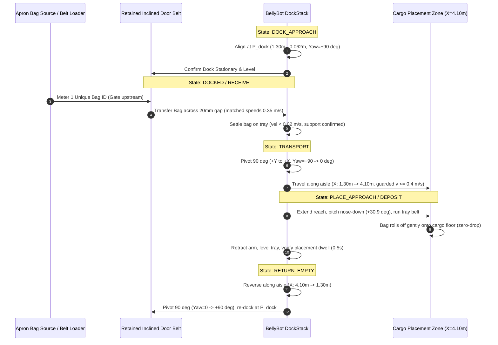

# BellyBot Mission Variant: Docking & Supply Geometry Decision Record

**Document Version:** 1.0  
**Date:** 2026-10-15  
**Status:** Architecture Gate Evaluated & Approved for Implementation  
**Related Reference Images:** `references/reference_1.jpeg` (marked), `references/reference_2.jpeg` (clean)  
**Rendered Model Maps:** `scratch/removal_candidates_labelled.png`, `scratch/removal_comparison_3panel.png`  

---

## 1. Context & Problem Statement

The historical simulation setup (`transfer_resolved.sdf`) relied on two interior transfer assemblies:
1. `corner_transfer`: A 90° rotary elevating table ($0.96 \times 0.96\text{ m}$ base, 3-stage lift $\Delta z = 0.198\text{ m}$, 90° clockwise rotation).
2. `longitudinal_buffer`: A $1.60\text{ m}$ long belt conveyor running along $+X$ with a 7-roller motorized folding bridge plate ($0.228\text{ m}$) that coupled into the rear of BellyBot.

In this layout, BellyBot was locked stationary at work datum $(4.100, 0.000, 0.003\text{ m})$.

Per the hackathon storyboard handoff, **both interior transfer assemblies are removed** from the active mission variant. The exterior `belt_loader` and the doorway `door_belt` are retained.

### The 198 mm Height Mismatch
- Retained `door_belt`: Outer end at $Y = -2.588\text{ m}$ (meeting `belt_loader`), inner end at $Y = -0.512\text{ m}$ (door sill threshold). Baseline surface height is $Z = 0.300\text{ m}$.
- Retained BellyBot receiving tray: At stowed mast lift ($0.0\text{ m}$), nominal tray belt receiving surface is $Z = 0.498\text{ m}$ (measured from floor at $Z = 0.003\text{ m}$).
- Vertical gap: $\Delta Z = 0.498 - 0.300 = 0.198\text{ m} = 198\text{ mm}$.
- Requirement: No unmodelled $198\text{ mm}$ bag jump, no hidden conveyor, and no bag spawner inside the robot.

---

## 2. Geometric Solution: Coherent Incline Re-Height Transition

Rather than introducing an ungrounded interior elevator mechanism, we modify the retained `door_belt` fixture geometry to form a gentle powered inclined plane:
1. **Outer End ($Y = -2.588\text{ m}$):** Surface height remains $Z = 0.300\text{ m}$, perfectly continuous with the external apron `belt_loader` discharge ($Z = 0.300\text{ m}$).
2. **Inner Dock End ($Y = -0.512\text{ m}$):** Surface height rises continuously to $Z = 0.498\text{ m}$, exactly matching BellyBot's receiving roller and belt level.
3. **Slope & Friction Feasibility:**
   - Active belt length: $L = 2.076\text{ m}$.
   - Vertical rise: $\Delta Z = 0.198\text{ m}$.
   - Incline angle: $\theta = \arcsin(0.198 / 2.076) = 5.48^\circ$ ($0.0956\text{ rad}$).
   - Rubber belt friction coefficient: $\mu = 0.60$ (static friction angle $\phi = \arctan(0.60) \approx 31.0^\circ$).
   - Safety factor against slip: $\tan(31.0^\circ) / \tan(5.48^\circ) \approx 6.25 \gg 1.0$. Luggage will not slide or roll backward under contact dynamics.
4. **Doorway Headroom Clearance:**
   - Boeing 737 cargo door sill is at $Z = 0.000\text{ m}$, clear door aperture height is $0.890\text{ m}$ (header at $Z = 0.890\text{ m}$).
   - Door sill centerline is at $Y = -1.560\text{ m}$.
   - Incline height at door sill: $Z_{\text{sill}} = 0.300 + \frac{-1.560 - (-2.588)}{2.076} \times 0.198 = 0.300 + 0.098 = 0.398\text{ m}$.
   - Headroom to door header: $0.890 - 0.398 = 0.492\text{ m} = 492\text{ mm}$.
   - Maximum design suitcase height: $0.380\text{ m}$ (conservative hackathon envelope).
   - Net vertical door margin with max bag: $492\text{ mm} - 380\text{ mm} = 112\text{ mm} > 100\text{ mm}$ margin!

---

## 3. Computed Full-Body Docking Coordinate

### 3.1 Link Transforms & Interface
- `door_belt` discharge edge: $X = 1.300\text{ m}$, $Y = -0.512\text{ m}$, $Z_{\text{surf}} = 0.498\text{ m}$.
- BellyBot receiving tray:
  - Belt dimension: $0.860\text{ m}$ length $\times 0.550\text{ m}$ width.
  - Centered at $(0.000, 0.000)$ relative to `base_link`.
  - Rear tray lip: $X_{\text{local}} = -0.430\text{ m}$.
- Docking orientation: Robot heading $\text{Yaw} = +90.0^\circ$ ($+1.5708\text{ rad}$, facing $+Y$).
  - With heading $+90^\circ$, local $-X$ points in world $-Y$.
  - Rear tray lip world position: $Y_{\text{rear}} = Y_{\text{dock}} - 0.430\text{ m}$.
  - Target transfer gap: $0.020\text{ m}$ ($20\text{ mm}$) nominal clearance between rollers.
  - Solving for $Y_{\text{dock}}$:
    $$Y_{\text{dock}} - 0.430 = -0.512 + 0.020 \implies Y_{\text{dock}} = -0.062\text{ m}$$

### 3.2 Full Dock SE(3) Pose
$$\mathbf{P}_{\text{dock}} = [X=1.300\text{ m}, Y=-0.062\text{ m}, Z=0.003\text{ m}, \text{Roll}=0^\circ, \text{Pitch}=0^\circ, \text{Yaw}=+90.0^\circ]$$

### 3.3 Collision & Space Clearance at Dock
1. **Lateral Hold Clearance:**
   - Centerline of aircraft cargo hold is $Y = 0.000\text{ m}$.
   - Robot center at $Y = -0.062\text{ m}$ is virtually on the hold centerline.
   - Robot track width is $0.880\text{ m}$ ($X \in [0.860, 1.740]\text{ m}$).
   - Door aperture is $X \in [0.690, 1.910]\text{ m}$ ($1.22\text{ m}$ width). The robot fits completely within the door projection zone.
2. **Longitudinal Clearance (Along Y):**
   - Robot overall chassis length: $1.250\text{ m}$.
   - Front nose at $Y = -0.062 + 0.625 = +0.563\text{ m}$.
   - Distance to port curved wall: Flat aisle extends to $Y = +0.900\text{ m}$. Margin $= +0.337\text{ m} = 337\text{ mm} \gg 25\text{ mm}$ wall safety margin.
   - Rear lip at $Y = -0.492\text{ m}$, located in the door threshold alcove ($Y \in [-0.90, -1.56]\text{ m}$).
3. **Ceiling Clearance:**
   - Stowed robot height: $0.468\text{ m}$ ($Z_{\text{top}} = 0.471\text{ m}$).
   - Aircraft hold ceiling at $(1.300, -0.062)$ is $Z = 1.150\text{ m}$.
   - Vertical clearance: $1.150 - 0.471 = 0.679\text{ m} = 679\text{ mm} \gg 100\text{ mm}$ roof safety margin.
   - With max $0.380\text{ m}$ bag on tray ($Z_{\text{bag\_top}} = 0.878\text{ m}$): Headroom $= 1.150 - 0.878 = 0.272\text{ m} = 272\text{ mm} > 100\text{ mm}$ margin.
4. **Turning Swept Envelope:**
   - In-place pivot radius: $R = \sqrt{(0.82/2)^2 + (0.72/2)^2} = 0.546\text{ m}$ ($1.092\text{ m}$ diameter).
   - Cargo aisle flat floor width: $1.800\text{ m}$.
   - Swept turn margin: $\frac{1.800 - 1.092}{2} = 0.354\text{ m} = 354\text{ mm}$ on both sides.

---

## 4. Door-Docked Shuttle Cycle Workflow

---

## 5. Unloading & Withdrawal Logistics

1. **Unloading Sequence:**
   - Robot approaches frontmost accessible bag at placement zone.
   - Lowers tray nose, rotates belts toward tray, acquires bag.
   - Retracts to carrying configuration, drives in reverse/return to dock pose $\mathbf{P}_{\text{dock}}$.
   - Reverses `tray_belt` and `door_belt` (speed negative, heading $-Y$).
   - Bag transfers across threshold onto `door_belt`, down the $5.48^\circ$ slope, onto `belt_loader` toward the apron.
   - Optical discharge plane at $Y = -2.60\text{ m}$ logs `unload_complete`.
2. **Ground Crew Changeover / Withdrawal:**
   - Entry platform / ramp configuration is replaced or repositioned during initial setup.
   - At operation conclusion, robot drives into stowed egress pose, door supply is withdrawn by standard ground support equipment procedure, and door is secured.
